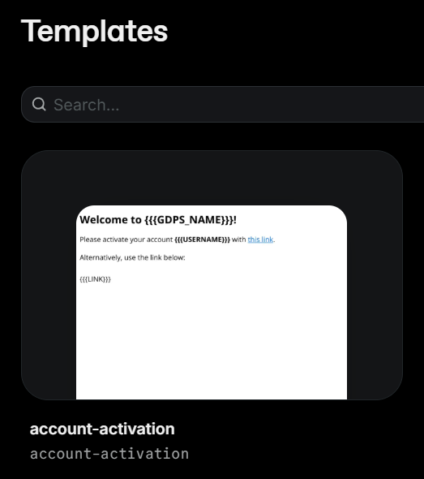
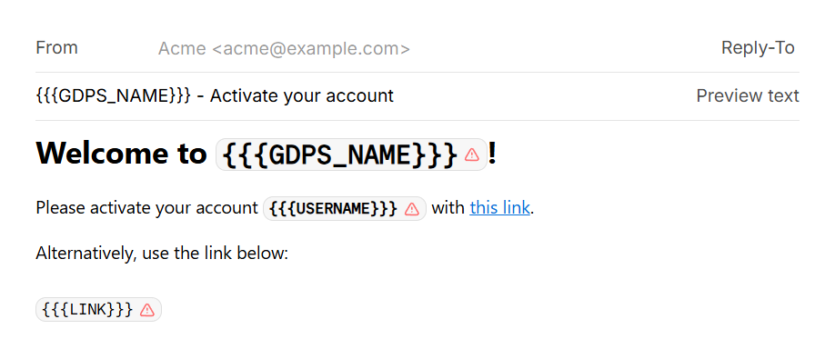

# Account Activation

By default, requiring account activation after registering is disabled.

If you enable this, you must set up Resend.

1. Set `require_account_activation` to true in `server.conf`.
2. Get your [Resend API key](https://resend.com/api-keys), then paste it into `server.conf`.
3. Create a [template](https://resend.com/templates). By default, the required name is `account-activation`. This can be changed in `server.conf`.

Below is what the templates page should look like:

4. Design your template. The server sends 3 different variables that you can use in the template:
- `USERNAME` - Username of the user registering
- `LINK` - The link that activates the user's account
- `GDPS_NAME` - The name of your GDPS set in `server.conf`

Below is an example template:

